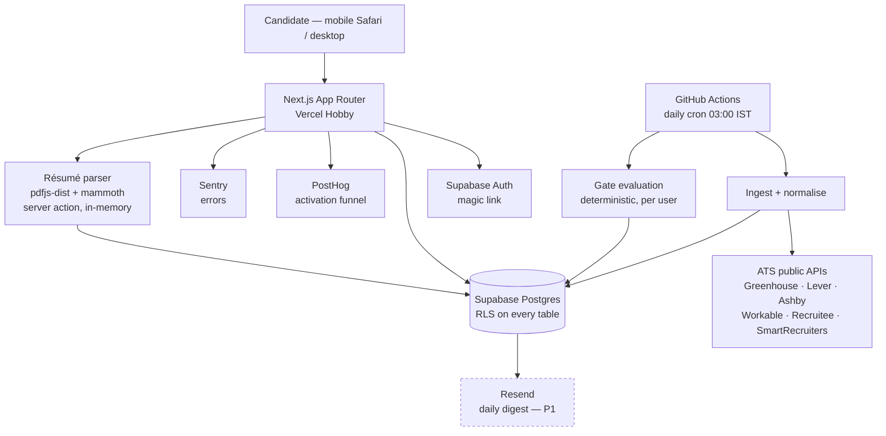

# PRD — Saaf

*Drafted: September 2026. Built from the approved MVP scoping outline, `docs/PRODUCT.md`, `docs/DESIGN.md`, and the Define/Design work products in `productos/`.*

---

## ⚠️ Amendment — 2026-09-04/05: the gate specification is superseded

**Read this before any section below.** This PRD specifies a product that gates.
Stages A–C reversed that, deliberately; `docs/PROJECT-STATE.md` § The pivot is
the governing record. The spec is kept whole rather than rewritten — it is
~10,000 words and most of it (data model, auth, API shape, error handling,
non-functional requirements) is unaffected — but where it and the pivot disagree,
**the pivot wins.**

**What changed, by section:**

- **§1 Overview, §6 Functional Requirements, §8 UI/UX.** Every clearance verdict,
  withheld row, refusal reason and stretch tier is history. `src/match/score.ts`
  scores six weighted components summing to 100 — title 28, seniority 25, skills
  20, location 10, credential 10, work mode 7 — normalised over the components
  that apply, and every role scoped to the candidate's preferred role is shown in
  rank order. The three-section shortlist is one ranked list.
- **§2 Technical Architecture.** Requirement extraction (`src/gates/extract.ts`)
  survives and still types what it reads; the verdict path
  (`src/gates/evaluate.ts`) has one live caller left, the fixture demo. Ingest is
  a concurrency-6 pool with a 38 s start-cutoff, not a sequential run.
- **§3 Data Model.** `gate_results.score_breakdown` now carries the itemised
  score. `profiles.skills` and `profiles.domain` were added by migration 0014.
  `profiles.channel_budget` / `institute_tier` / `hr_track` (migration 0008) are
  now written by nothing and read by nothing — onboarding stopped branching per
  function.
- **§4 API Specification.** `/api/audit/today` still returns a `rolesWithheld`
  field; it is hard-written as 0 and read by nothing.
- **§12 Dependencies.** A language model is now in the résumé path — Gemini Flash
  reads skills and domain (`src/lib/parse/llm.ts`), strictly additive, null on any
  failure. §13's "no LLM in the MVP" line is superseded by a narrower rule: a
  model **reads, never decides.**
- **§13 Out of Scope.** The deferred *gating* logic for marketing, consulting and
  HR is not merely still deferred — there is no gate to defer it into, and the
  score has no component for those requirement kinds either.

**Unaffected and still authoritative:** the data model's shape and RLS posture,
auth (§9), edge cases (§11), non-functional requirements (§7), and the standing
rule that a backend failure must never render as a verdict about the candidate.

---

## 1. Overview

### Product Summary

**Saaf** — *a daily shortlist of roles you can actually get, ranked by honest odds.*

Saaf is a free daily job shortlist for Indian professionals in their first five years of work. It pulls openings from a curated registry of Indian companies' own applicant-tracking boards and, before anything is scored, removes every role the candidate is structurally disqualified from. What survives is ranked with a one-line reason attached to each score — and, on the same screen, every role that was withheld appears struck through with the reason it was refused. The product's distinguishing act is not matching; it is refusing, and publishing what it refused.

### Objective

This PRD covers the MVP as fixed in the scoping interview: the core loop plus the P0 feature set, with P1 named but not required for launch.

**Core loop:** Upload a résumé → confirm the parsed profile → gates run against today's indexed roles → the shortlist appears with the withheld section and a stated reason on every line.

**In scope (P0):** hand-seeded ATS registry (~30–40 boards), daily ingest job, minimal role normalisation, typed gate engine for **two** functions (engineering: experience band; finance: credential), résumé parse-and-delete, parse-then-confirm profile, magic-link auth, the shortlist with cleared and withheld rows, honest empty-state arithmetic, the "this shouldn't be here" defect report, one-click account deletion, and analytics instrumentation of the activation funnel.

**P1 (ships if time allows, first thing after if not):** the standalone public gate-audit page, the stretch tier, the daily email digest, full ESCO/O\*NET normalisation, and the remaining three gate functions (marketing, consulting, HR).

**P2 (deferred, see §13):** document generation, the fabrication guard, registry auto-discovery, multi-provider LLM routing, and open-sourcing the gate.

### Market Differentiation

Every competitor in this category sells *more, faster*, and proves it with numbers nobody can check — Jobright's homepage claims "3x interviews landed" and "2,000,000+ users". Saaf sells *fewer, honest*, and proves it with a refusal any candidate can verify against the job description in thirty seconds. Three things must be true in the implementation for that differentiation to survive contact with users. **Gates run in plain deterministic code, never in a model** — a language model asked to judge eligibility weighs when it should gate, which is precisely how the "Top Applicant on a fifteen-year role" failure is born. **Every refusal carries the specific requirement that triggered it**, extracted from the job description and stored alongside the decision, so the reason is retrieved rather than generated. **The refusal counts are aggregated and publishable from day one**, because the landing page's only proof is the audit.

### Magic Moment

> When the candidate reads the withheld section of their first shortlist and recognises a disqualifier as true — *"asks for a chartered accountant; your profile doesn't carry one"* — software has told them **no**, with a reason they know is correct.

**Position:** first session, immediately after profile confirmation. **Target:** under 90 seconds from the first onboarding screen (estimated 63s across the seven-screen flow).

What the implementation must get right:

- **The withheld section renders in the first shortlist paint**, open by default, never lazy-loaded behind a control or a scroll trigger. If the user has to expand it, the aha does not fire.
- **The withheld count appears in the arithmetic line above the fold**, so the section is discoverable without scrolling.
- **Gate evaluation is precomputed**, not calculated on page load. The shortlist is a read of stored results.
- **A wrong refusal is the catastrophic failure**, worse than a wrong match — it reproduces the exact injury the product exists to fix, with more authority than a portal ever had. Every withheld row therefore carries a one-tap report, and reports are triaged as defects.

### Success Criteria

| # | Criterion | Measured by |
|---|---|---|
| 1 | A new user reaches the shortlist in **under 90 seconds** from onboarding screen 1 | PostHog funnel, p50 |
| 2 | **≥60%** of new profiles engage the withheld section in session 1, and **<5%** file a "this shouldn't be here" report | PostHog event + `refusal_reports` table |
| 3 | **100% eligibility rate** — every role shown is one the candidate judges themselves genuinely eligible for | First-cohort survey |
| 4 | The core loop completes on **mobile Safari at 390px** | Manual device test, part of P0 acceptance |
| 5 | The registry **ingests for 7 consecutive days with no manual intervention**, and every P0 feature passes its acceptance criteria | GitHub Actions run history |

---

## 2. Technical Architecture

### Architecture Overview



Three things to read off this diagram. **The résumé file never reaches the database** — it is parsed in memory inside a server action and discarded; only confirmed profile fields persist. **Scoring runs in the cron, not on request** — the shortlist is a read of precomputed rows, which is what makes the 90-second target achievable. ~~**No language model appears anywhere in the MVP.**~~ *Superseded 2026-09-05 (Stage C): a model reads skills and domain off the résumé inside the same server action, before anything persists. It reads; it never decides. The diagram's first claim is unchanged — the file still never reaches the database.*

### Chosen Stack

| Layer | Choice | Rationale |
|---|---|---|
| Frontend | **Next.js (App Router)** on Vercel Hobby | First-party host on the verified free tier; server actions keep résumé bytes off the client-to-DB path; mobile-first responsive |
| Backend + Database | **Supabase (Postgres)** | The workload is batch-relational — ~3,000 roles churning daily, filter-heavy queries, and a gate audit that is a `GROUP BY reason`. Chosen over Convex deliberately: real-time reactive sync is Convex's strength and this product updates once a day |
| Auth | **Supabase Auth**, magic link | Bundled with the database, no extra service, no password storage, no social provider dependency |
| **Payments** | **None** | ₹0 forever with no paid tier. Not merely "not yet": advertising a paid product would breach the Vercel Hobby non-commercial terms this product is hosted under |
| Scheduled ingest | **GitHub Actions** cron | Verified more generous than Vercel Hobby's two-job cron cap; keeps the pipeline independent of the web host |
| Résumé parsing | **pdfjs-dist** + **mammoth**, deterministic | Parse-then-confirm onboarding means the parser does not need to be accurate — the confirmation screen absorbs its errors. A library beats a model here: free, fast, no provider dependency, and no risk of inventing an employer |
| Analytics | **PostHog** free tier | Success criteria 1 and 2 are unmeasurable without funnel instrumentation |
| Email | **Resend** | Verified 3,000/month free; magic links at P0, daily digest at P1 |
| Error tracking | **Sentry** free tier | Launch essential |
| LLM | **None in MVP** | Not on the critical path. Arrives with document generation in P2 |

### Stack Integration Guide

**Setup order.** Supabase project and schema first, because everything reads from it. Then Next.js with `@supabase/ssr` wired for App Router cookie-based sessions. Then the GitHub Actions ingest, which can run against the schema before any UI exists. Then the screens. PostHog, Sentry and Resend last, but before the first real user.

**Supabase + Next.js App Router.** Use `@supabase/ssr`, not the deprecated auth-helpers. Create three client factories: a browser client for client components, a server client that reads and writes cookies for server components and actions, and a **service-role client used only inside the GitHub Actions job** — never inside anything the browser can reach. The service-role key bypasses RLS entirely; it belongs in Actions secrets, never in a `NEXT_PUBLIC_*` variable.

**RLS from the first migration, not retrofitted.** Every table gets policies in the same migration that creates it. `profiles`, `gate_results` and `refusal_reports` are scoped to `auth.uid()`. `boards`, `roles` and `role_requirements` are readable by any authenticated user and writable only by the service role. `audit_daily` is readable by anonymous users, because the landing page renders it before signup.

**Known gotchas, specific to this combination.**

- **ATS boards are global.** Every provider returns worldwide roles; the live probe found 233 roles of which only 137 were in India. Location filtering happens at ingest, not at query time, or the registry fills with San Francisco listings.
- **Provider response shapes differ per ATS.** Greenhouse returns `{jobs: [...]}`, Lever a bare array, Ashby `{jobs: [...]}` under a different key. Write one adapter per provider with a shared normalised output type; do not attempt a generic parser.
- **Vercel server actions have a body size limit.** Résumé uploads must be capped client-side (5 MB is generous for a CV) with a clear error, not left to fail at the platform boundary.
- **GitHub Actions runs in UTC.** The 03:00 IST daily schedule is `30 21 * * *` the previous day. Get this wrong and the digest lands at breakfast in the wrong timezone.
- **Supabase free tier pauses a project after 7 days of inactivity.** The daily cron incidentally prevents this; do not remove it during quiet periods without a keepalive.

**Environment variables.**

```
NEXT_PUBLIC_SUPABASE_URL          # public by design
NEXT_PUBLIC_SUPABASE_ANON_KEY     # public by design — safe because RLS holds
SUPABASE_SERVICE_ROLE_KEY         # GitHub Actions secret ONLY, never in the app bundle
NEXT_PUBLIC_POSTHOG_KEY           # public by design
NEXT_PUBLIC_POSTHOG_HOST
RESEND_API_KEY                    # server only
SENTRY_DSN                        # server only
SENTRY_AUTH_TOKEN                 # build-time source map upload
```

### Repository Structure

```
saaf/
├── src/
│   ├── app/
│   │   ├── (marketing)/page.tsx        # landing page
│   │   ├── (marketing)/audit/page.tsx  # public gate audit — P1
│   │   ├── (onboarding)/start/          # screens 1-5 of the flow
│   │   ├── (app)/today/page.tsx         # the shortlist — the magic moment
│   │   ├── (app)/profile/page.tsx       # edit confirmed profile, delete account
│   │   ├── auth/callback/route.ts       # magic-link exchange
│   │   └── api/report/route.ts          # "this shouldn't be here"
│   ├── components/
│   │   ├── ui/                          # primitives built from docs/DESIGN.md tokens
│   │   └── features/
│   │       ├── role-row.tsx             # cleared / withheld / stretch — the three states
│   │       └── arithmetic.tsx           # 3,200 → 47 → 3
│   ├── lib/
│   │   ├── supabase/{browser,server,service}.ts
│   │   ├── parse/{pdf,docx,extract}.ts  # résumé → candidate fields
│   │   └── analytics.ts
│   └── gates/                           # ⚠️ the moat's public half — see below
│       ├── types.ts                     # TypedRequirement, GateResult
│       ├── engineering.ts               # experience-band gate
│       ├── finance.ts                   # credential gate
│       └── evaluate.ts                  # pure: (profile, requirements) => GateResult
├── ingest/
│   ├── providers/{greenhouse,lever,ashby,workable,recruitee,smartrecruiters}.ts
│   ├── normalise.ts                     # role → function, location, requirements
│   └── run.ts                           # entry point for the Actions job
├── registry/boards.json                 # ⚠️ PRIVATE — the moat. Never open-sourced
├── supabase/migrations/
└── .github/workflows/daily-ingest.yml
```

**`src/gates/` and `registry/boards.json` are deliberately separated.** The locked decision is *open-source the gate, keep the registry private*. Keeping gate logic in a directory with no imports from `registry/` or `ingest/` means it can be extracted to a public repository later without untangling anything. Write `evaluate.ts` as a pure function over plain data for the same reason.

### Infrastructure & Deployment

Vercel Hobby, deployed with the **Vercel CLI** rather than the GitHub integration: this GitHub account cannot authorise third-party OAuth applications, so Vercel cannot be linked to the repository. `npx vercel` creates the project, `npx vercel --prod` ships it. Pushes to GitHub still work and still serve as the code backup — they simply do not trigger a deploy. The production URL is a `*.vercel.app` subdomain — no custom domain, per the confirmed hosting intent.

**The scheduler is Vercel Cron, not GitHub Actions — corrected 2026-09-03.** The earlier reasoning here was that Actions is first-party and therefore unaffected by the OAuth restriction. That was an untested inference and it was wrong: `workflow_dispatch` returns `HTTP 422: Actions has been disabled for this user`. Push and repository access work; only Actions are blocked. The ingest code did not move — only its trigger, to `src/app/api/cron/ingest/route.ts` scheduled from `vercel.json`.

⚠️ **This carries a ceiling.** Vercel Hobby caps a function at 60 seconds, and Hobby cron fires once daily so the work cannot be chunked across invocations. The run takes ~34s at 20 boards — roughly 1.7s per board — so **it will time out somewhere past 30 boards.** Since the registry compounding is the moat, that is a *when*, not an *if*. Migrate to a Supabase Edge Function on `pg_cron` (150s, no Vercel ceiling) before the registry passes 30 boards. The adapters and gate code are runtime-agnostic; only the trigger and the Supabase client import change.

The ingest job is **not** on Vercel. It runs as a GitHub Actions workflow on a cron, using the Supabase service-role key from Actions secrets. This keeps it clear of Hobby's two-job cron cap and means a Vercel outage does not stop the registry compounding.

Database migrations live in `supabase/migrations/` and are applied with the Supabase CLI. Do not edit schema through the dashboard — the migration files are the source of truth, and RLS policies must be reviewable in version control.

### Security Considerations

**The résumé is the sensitive asset, and the design minimises it.** The uploaded file is read into memory inside a server action, parsed, and discarded in the same request. It is never written to Supabase Storage, never logged, and never sent to a third party. Only the fields the candidate explicitly confirms are persisted. This is the DPDP posture and the third guarantee, enforced structurally rather than by policy.

**Authorization is ownership-based, server-side.** Every query filters on `auth.uid()` through RLS, not through client-side checks. A user reading another user's `gate_results` must be impossible at the database level, not merely absent from the UI.

**Key handling.** The anon key is public by design and safe *because* RLS holds — which makes RLS a security control, not a nicety. The service-role key exists only in GitHub Actions secrets. Any code path where a service-role client could be reached from a request handler is a defect.

**Input validation** with `zod` at every boundary: the résumé upload (MIME type, size), the profile confirmation form, and the report endpoint. Job-description text from ATS providers is untrusted third-party content — it is parsed for requirements and rendered as text, never as HTML.

**Rate limiting** on the magic-link endpoint and the report endpoint, keyed by IP, to prevent enumeration and report flooding.

**Account deletion** is a single authenticated action that cascades: profile, gate results, reports, and the auth user. No email confirmation step, per the guarantee. It must be genuinely irreversible.

### Cost Estimate

First six months, under 1,000 users. Every layer is on a verified free tier.

| Service | Free tier limit | Expected usage | Cost |
|---|---|---|---|
| Vercel Hobby | Non-commercial, 100 GB bandwidth | Well under | ₹0 |
| Supabase | 500 MB database, 50k monthly active users | ~3k roles/day with a 30-day retention window ≈ 90k rows; comfortable | ₹0 |
| GitHub Actions | 2,000 minutes/month (free for public repos) | ~30 runs/month × ~3 min ≈ 90 min | ₹0 |
| PostHog | 1M events/month | Far under at this scale | ₹0 |
| Resend | 3,000 emails/month | Magic links + P1 digest | ₹0 |
| Sentry | 5,000 errors/month | Far under | ₹0 |
| **Total** | | | **₹0/month** |

**The two ceilings to watch.** Supabase's 500 MB fills if role history is never pruned — the ingest must delete roles older than 30 days. And Vercel Hobby is non-commercial *only*: introducing or even advertising a paid tier requires moving to Pro first, which is why §10 is empty by decision rather than omission.

---

## 3. Data Model

Postgres via Supabase. Every table carries RLS policies in the same migration that creates it. Timestamps are `TIMESTAMPTZ`; the application timezone is IST but storage is UTC.

### Entity Definitions

```sql
-- Company ATS boards. The registry: hand-seeded, private, the moat.
CREATE TABLE boards (
  id            UUID PRIMARY KEY DEFAULT gen_random_uuid(),
  provider      TEXT NOT NULL CHECK (provider IN
                  ('greenhouse','lever','ashby','workable','recruitee','smartrecruiters')),
  token         TEXT NOT NULL,              -- the board slug used in the provider's URL
  company_name  TEXT NOT NULL,
  active        BOOLEAN NOT NULL DEFAULT TRUE,
  last_ingested_at TIMESTAMPTZ,
  last_error    TEXT,                       -- null when the most recent run succeeded
  created_at    TIMESTAMPTZ NOT NULL DEFAULT NOW(),
  UNIQUE (provider, token)
);

-- One row per live role. Rebuilt daily; rows older than 30 days are pruned.
CREATE TABLE roles (
  id            UUID PRIMARY KEY DEFAULT gen_random_uuid(),
  board_id      UUID NOT NULL REFERENCES boards(id) ON DELETE CASCADE,
  external_id   TEXT NOT NULL,              -- the provider's own job id
  title         TEXT NOT NULL,
  location_raw  TEXT,                       -- as returned by the provider
  in_india      BOOLEAN NOT NULL,           -- resolved at ingest; ATS boards are global
  city          TEXT,
  function      TEXT CHECK (function IN
                  ('engineering','finance','marketing','consulting','hr','other')),
  description   TEXT NOT NULL,              -- untrusted third-party text, render as text only
  apply_url     TEXT NOT NULL,
  posted_at     TIMESTAMPTZ,
  first_seen_at TIMESTAMPTZ NOT NULL DEFAULT NOW(),
  last_seen_at  TIMESTAMPTZ NOT NULL DEFAULT NOW(),
  UNIQUE (board_id, external_id)
);

-- The typed requirements extracted from a role's description.
-- One role may carry several; the gate engine evaluates every one.
CREATE TABLE role_requirements (
  id            UUID PRIMARY KEY DEFAULT gen_random_uuid(),
  role_id       UUID NOT NULL REFERENCES roles(id) ON DELETE CASCADE,
  kind          TEXT NOT NULL CHECK (kind IN
                  ('experience_years','credential','location','work_authorisation',
                   'channel_budget','institute_tier','hr_track','title_seniority')),
  -- exactly one of these carries the value, depending on kind
  min_years     NUMERIC(4,1),               -- kind = experience_years
  credential    TEXT CHECK (credential IN ('CA','CFA','CS','none')),
  value_text    TEXT,                       -- location / work_authorisation / others
  source_quote  TEXT NOT NULL,              -- the sentence this was extracted from
  confidence    NUMERIC(3,2) NOT NULL,      -- 0.00-1.00; below threshold = do not gate
  created_at    TIMESTAMPTZ NOT NULL DEFAULT NOW()
);

-- The candidate's confirmed profile. Never populated by the parser alone.
CREATE TABLE profiles (
  id                 UUID PRIMARY KEY REFERENCES auth.users(id) ON DELETE CASCADE,
  current_title      TEXT,
  employer           TEXT,
  years_experience   NUMERIC(4,1),
  function           TEXT CHECK (function IN
                       ('engineering','finance','marketing','consulting','hr')),
  city               TEXT,
  work_authorisation TEXT,
  credential         TEXT CHECK (credential IN ('CA','CFA','CS','none')),
  confirmed_at       TIMESTAMPTZ,           -- NULL until the user confirms; gates will not run
  portals_used       TEXT[],                -- from onboarding screen 1
  created_at         TIMESTAMPTZ NOT NULL DEFAULT NOW(),
  updated_at         TIMESTAMPTZ NOT NULL DEFAULT NOW()
);

-- Precomputed gate outcome per (user, role). The shortlist is a read of this table.
CREATE TABLE gate_results (
  id              UUID PRIMARY KEY DEFAULT gen_random_uuid(),
  user_id         UUID NOT NULL REFERENCES auth.users(id) ON DELETE CASCADE,
  role_id         UUID NOT NULL REFERENCES roles(id) ON DELETE CASCADE,
  outcome         TEXT NOT NULL CHECK (outcome IN ('cleared','withheld','stretch')),
  refused_on      TEXT CHECK (refused_on IN
                    ('experience_years','credential','location','work_authorisation',
                     'channel_budget','institute_tier','hr_track')),
  reason          TEXT NOT NULL,            -- templated from the gate, never generated
  score           NUMERIC(4,1),             -- NULL when withheld; nothing is scored after refusal
  gap_years       NUMERIC(4,1),             -- stretch tier only, <= 2.0
  computed_at     TIMESTAMPTZ NOT NULL DEFAULT NOW(),
  UNIQUE (user_id, role_id)
);

-- "This shouldn't be here." Triaged as defects, and half of success criterion 2.
CREATE TABLE refusal_reports (
  id            UUID PRIMARY KEY DEFAULT gen_random_uuid(),
  user_id       UUID NOT NULL REFERENCES auth.users(id) ON DELETE CASCADE,
  gate_result_id UUID NOT NULL REFERENCES gate_results(id) ON DELETE CASCADE,
  note          TEXT,
  resolved_at   TIMESTAMPTZ,
  created_at    TIMESTAMPTZ NOT NULL DEFAULT NOW(),
  UNIQUE (user_id, gate_result_id)
);

-- Daily aggregate for the public gate audit. Anonymous-readable: the landing page
-- renders it before signup, which is why it is a table and not a live query.
CREATE TABLE audit_daily (
  day             DATE PRIMARY KEY,
  roles_indexed   INTEGER NOT NULL,
  roles_withheld  INTEGER NOT NULL,
  boards_active   INTEGER NOT NULL,
  by_reason       JSONB NOT NULL,           -- {"experience_years":1204,"credential":431,...}
  created_at      TIMESTAMPTZ NOT NULL DEFAULT NOW()
);
```

### Relationships

| From | To | Type | Cascade |
|---|---|---|---|
| `boards` | `roles` | 1:many | Deleting a board deletes its roles |
| `roles` | `role_requirements` | 1:many | Deleting a role deletes its requirements |
| `auth.users` | `profiles` | 1:1 | Deleting the auth user deletes the profile |
| `auth.users` | `gate_results` | 1:many | Cascade — account deletion must leave nothing |
| `roles` | `gate_results` | 1:many | A pruned role removes its gate results |
| `gate_results` | `refusal_reports` | 1:many | Cascade |

**`gate_results` is the join that matters** and it is deliberately materialised rather than computed. Evaluating gates for every user against every role at request time would put a multi-thousand-row scan on the 90-second path. The cron computes it; the page reads it.

**Account deletion is a single cascade from `auth.users`.** Every table holding user data references it with `ON DELETE CASCADE`, so the one-click guarantee is a database property rather than application cleanup that can be forgotten.

### Indexes

```sql
CREATE INDEX idx_roles_ingest        ON roles (in_india, function, last_seen_at DESC);
CREATE INDEX idx_roles_board         ON roles (board_id);
CREATE INDEX idx_role_req_role       ON role_requirements (role_id, kind);
CREATE INDEX idx_gate_user_outcome   ON gate_results (user_id, outcome, computed_at DESC);
CREATE INDEX idx_gate_role           ON gate_results (role_id);
CREATE INDEX idx_reports_open        ON refusal_reports (resolved_at) WHERE resolved_at IS NULL;
```

| Index | Why it exists |
|---|---|
| `idx_roles_ingest` | The gate job's driving query: India-only, matching the user's function, seen recently. Covers the hot path of the daily run |
| `idx_role_req_role` | Requirements are fetched per role, filtered by kind, once per evaluation |
| `idx_gate_user_outcome` | **The shortlist query.** Reads cleared and withheld rows for one user in one indexed scan — this index is what the 90-second target rests on |
| `idx_reports_open` | Partial index over unresolved reports only. Report triage is the defect surface promised in the guarantee, and it must stay cheap to poll |

---

## 4. API Specification

### API Design Philosophy

**Reads go direct to Supabase from server components via RLS; writes go through server actions.** There is no bespoke REST layer for CRUD, because RLS already enforces ownership at the database and duplicating that in route handlers would create two places for an authorization bug to live. Route handlers exist only where an external caller or a non-form trigger requires one.

**Authentication** is a Supabase session cookie, read server-side with `@supabase/ssr`. Server actions inherit it automatically.

**Error format** is uniform: `{ error: string, code: string }` with an appropriate status. Validation failures return `422` with `details` from `zod`'s flattened error.

**Pagination** is unnecessary in the MVP. A day's shortlist is tens of rows, and the withheld list is capped at 50 in the UI with a count of the remainder — a deliberate product choice, since the point is that refusals are *visible*, not that all of them are enumerated.

### Endpoints

**Server actions** — the primary surface.

```
parseResume(formData: FormData)
  Auth: required
  Accepts: file (application/pdf | .docx), max 5 MB
  Behaviour: parses IN MEMORY, returns extracted fields, PERSISTS NOTHING.
             The file is never written to storage and never logged.
  Returns: { fields: ParsedFields, warnings: string[] }
  Errors:  422 unsupported type · 413 too large · 500 unparseable
           (all three route the user to manual entry, never a dead end)

confirmProfile(input: ProfileInput)
  Auth: required
  Behaviour: upserts profiles for auth.uid(), sets confirmed_at = NOW(),
             then enqueues a first gate evaluation for this user.
  Returns: { ok: true, resultsReady: boolean }
  Note:    gates MUST NOT run against an unconfirmed profile — confirmed_at
           is the guard, and it is checked in the evaluator, not only the UI.

reportRefusal(gateResultId: string, note?: string)
  Auth: required, and the gate_result must belong to auth.uid() (enforced by RLS)
  Returns: { ok: true }
  Idempotent: UNIQUE (user_id, gate_result_id) — a second tap is not a second report

deleteAccount()
  Auth: required
  Behaviour: deletes the auth user; every dependent row cascades.
             No email confirmation step, per the guarantee.
  Returns: redirect to /
```

**Route handlers** — only where a server action cannot be used.

```
GET /auth/callback?code=...
  Auth: none (this is the magic-link exchange)
  Behaviour: exchanges the code for a session, sets cookies,
             redirects to /start if profiles.confirmed_at IS NULL, else /today
  Response 302

GET /api/audit/today
  Auth: NONE — deliberately public. The landing page renders this pre-signup.
  Returns 200: { day: string, rolesIndexed: number, rolesWithheld: number,
                 boardsActive: number, byReason: Record<string, number> }
  Caching: s-maxage=3600, stale-while-revalidate=86400
  Note: reads audit_daily, never computes. If today's row is absent
        (the cron has not run), it returns the most recent day with its date,
        never a zeroed row — a zero here would read as "we refused nothing".
```

**The ingest job is not an API.** It runs inside GitHub Actions with the service-role key and writes directly to Postgres. It deliberately has no HTTP surface: an endpoint that can trigger ingest is an endpoint that can be abused into hammering six third-party ATS providers from a Vercel IP.

Its stages, for reference: fetch each active board → normalise per-provider shapes → filter to India → extract typed requirements → upsert `roles` and `role_requirements` → prune roles unseen for 30 days → recompute `gate_results` for every confirmed profile → write today's `audit_daily` row.

---

## 5. User Stories

Written for **Rohan** — 24, two years at an IT services firm in Bengaluru, ₹7.5L, searching at 10pm on a personal phone because the work laptop is monitored — and **Arjun**, a chartered accountant two years post-qualification in audit. They are the two personas the MVP's two gate functions serve. Verbatim language is from `productos/define/2-Customer-Persona.md`.

### Epic: Getting a profile in

**US-001: Upload a résumé without handing over trust first**
As Rohan, I want to give Saaf my résumé and know immediately what happens to it, so that I'm not trading my privacy for a list I haven't seen yet.

Acceptance Criteria:
- [ ] Given the upload screen, when it renders, then the deletion promise is visible *beside the ask*, not behind a privacy link.
- [ ] Given a PDF or .docx under 5 MB, when I upload it, then fields are extracted and the file is discarded in the same request.
- [ ] Given an unparseable or oversized file, when upload fails, then I am routed to manual entry with the fields I'd have filled anyway — never a dead end.
- [ ] Edge case: I close the tab mid-parse → nothing is persisted, because nothing is persisted until confirmation.

**US-002: Correct what the parser got wrong**
As Rohan, I want to check every field before anything runs, so that a bad parse doesn't become a bad shortlist.

Acceptance Criteria:
- [ ] Given parsed fields, when the confirm screen renders, then every field is pre-filled and marked "read from your résumé".
- [ ] Given I change a field, when I confirm, then the changed value is stored and the parsed value is not retained.
- [ ] Given any required field is empty, when I try to confirm, then I'm blocked with "We need this to run the experience gate."
- [ ] Edge case: profile confirmed but `confirmed_at` write fails → gates do not run, and I'm returned to the confirm screen rather than shown an empty shortlist.

**US-003: Answer the gate that actually applies to me**
As Arjun, I want to be asked about my credential rather than my years, so that the product proves it understands how finance hiring actually filters.

Acceptance Criteria:
- [ ] Given I confirmed function = finance, when the gate screen renders, then it asks which credential I hold — CA, CFA, CS, or none of these.
- [ ] Given I confirmed function = engineering, when the gate screen renders, then it asks years of experience instead.
- [ ] Given I answer "none of these", when I continue, then I am **not** turned away, and roles requiring a credential are withheld with that reason stated.

### Epic: The shortlist

**US-004: See what cleared, with the reason for the score**
As Rohan, I want each role to arrive with the one line explaining its number, so that I can judge the call instead of trusting it.

Acceptance Criteria:
- [ ] Given cleared results exist, when the shortlist renders, then each row shows title, company, city, score, and a one-line reason.
- [ ] Given a reason, when I read it, then it names the specific requirement that produced the gap.
- [ ] Edge case: zero cleared roles → the honest arithmetic renders, attributing thinness to coverage, never to me.

**US-005: See what was withheld, and recognise it as true — ★ the magic moment**
As Rohan, I want to see the roles Saaf refused and why, so that I can check the call in thirty seconds and decide whether to trust the short list.

Acceptance Criteria:
- [ ] Given withheld results exist, when the shortlist first paints, then the withheld section is **already open** — not collapsed, not lazy-loaded, not behind a scroll trigger.
- [ ] Given the arithmetic line renders above the fold, then it carries the withheld count, so the section is discoverable without scrolling.
- [ ] Given a withheld row, when I read it, then the title is struck through and the reason names the exact disqualifier: *"asks for a chartered accountant; your profile doesn't carry one."*
- [ ] Given a withheld row, when I read it, then it uses the same size, measure and rule as a cleared row — it must not read as an error, a warning, or disabled content.
- [ ] Edge case: more than 50 withheld roles → the first 50 render with a count of the remainder. Refusals must be *visible*, not exhaustively enumerated.

**US-006: Report a refusal that's wrong**
As Arjun, I want one tap to say "this shouldn't be here", so that a wrong refusal is a defect someone fixes rather than a verdict I have to accept.

Acceptance Criteria:
- [ ] Given any withheld row, when I tap the report link, then a report is recorded against that gate result.
- [ ] Given I tap it twice, when the second tap lands, then no duplicate is created.
- [ ] Given a report exists, when it is unresolved, then it appears in the open-reports index for triage.

### Epic: Trust and exit

**US-007: Leave completely, in one click**
As Rohan, I want to delete my account without emailing anyone, so that the confidentiality promise is something I can exercise rather than read.

Acceptance Criteria:
- [ ] Given I'm signed in, when I confirm deletion, then the auth user is deleted and every dependent row cascades.
- [ ] Given deletion completes, when I revisit, then no profile, results or reports remain.
- [ ] Given the flow, when I use it, then no email confirmation step is required.

---

## 6. Functional Requirements

### Supply

**FR-001: ATS registry**
Priority: P0
Description: A hand-seeded registry of 30–40 Indian company job-board tokens across the six supported providers, stored in `registry/boards.json` and synced into `boards`. Private; never open-sourced.
Acceptance Criteria:
- 30+ active boards across at least four of the six providers
- Each board records provider, token, company name
- A failing board records `last_error` and does not halt the run
Related Stories: US-004, US-005

**FR-002: Daily ingest**
Priority: P0
Description: A GitHub Actions cron at 03:00 IST fetching every active board, normalising per-provider response shapes, filtering to India, upserting `roles`, pruning roles unseen for 30 days.
Acceptance Criteria:
- One adapter per provider with a shared normalised output type
- Non-India roles are excluded at ingest, not at query time
- A provider outage fails that board only; the run completes
- Roles unseen for 30 days are deleted
Related Stories: US-004, US-005

**FR-003: Typed requirement extraction**
Priority: P0
Description: Extract typed requirements from role descriptions into `role_requirements`, with the source sentence and a confidence score. MVP extracts `experience_years`, `credential`, `location`, `work_authorisation`, and `title_seniority`.
Acceptance Criteria:
- Every extracted requirement stores the text it came from
- Confidence below the threshold (0.7) means the requirement is **not** used to gate
- Nothing is inferred from the *description* where the description is silent
- **`title_seniority` is read from the role title, which is stated text in the posting.** Its reason quotes the title and explicitly says the posting states no year count — it must never present a years figure the posting did not state
- Indian title conventions are honoured: "Assistant Manager" and "Senior Associate" are junior roles and are not gated; "Associate Director" is discounted rather than treated as a Director role
- Only a confidently framed statement (≥0.9, e.g. "must have 3+ years") may override a title band. An unframed mention must not suppress it
Related Stories: US-005

### The gate engine

**FR-004: Deterministic typed gate evaluation**
Priority: P0
Description: A pure function over `(profile, requirements)` returning cleared, withheld or stretch, plus the requirement that caused a refusal. Plain TypeScript in `src/gates/`. **No model is involved.**
Acceptance Criteria:
- Engineering gates on experience band; finance gates on credential
- A role failing any hard requirement is withheld regardless of skill fit
- Gates never run where `profiles.confirmed_at IS NULL`
- The evaluator has no imports from `registry/` or `ingest/`
- Unit tests cover: exact-boundary years, missing credential, credential held, silent description, low-confidence requirement
Related Stories: US-003, US-004, US-005

**FR-005: Templated refusal reasons**
Priority: P0
Description: Each refusal produces a reason string templated from the gate that fired and the requirement's stored value. Retrieved, never generated.
Acceptance Criteria:
- Credential refusal reads: "asks for a chartered accountant; your profile doesn't carry one. A credential can't be stretched."
- Experience refusal reads: "asks for {n} years; you have {m}."
- No reason text is produced by a language model
Related Stories: US-005

**FR-006: Stretch tier**
Priority: P1
Description: Roles failing *only* an experience requirement by ≤2 years are marked stretch and rendered on the bone-tinted surface with the gap labelled.
Acceptance Criteria:
- Applies only where the gate is experience-typed — a credential is never stretched
- Gap is capped at 2.0 years
- Never mixed into the cleared list
Related Stories: US-004

### Onboarding

**FR-007: Résumé parse and destroy**
Priority: P0
Description: Server action parsing PDF and .docx in memory with `pdfjs-dist` and `mammoth`, returning extracted fields and persisting nothing.
Acceptance Criteria:
- The file is never written to storage and never logged
- 5 MB cap enforced client-side with a clear message
- Any failure routes to manual entry
Related Stories: US-001

**FR-008: Parse-then-confirm profile**
Priority: P0
Description: Every parsed field is presented pre-filled and marked with its provenance; `confirmed_at` is set only on explicit confirmation, and gates will not run before it.
Acceptance Criteria:
- Each field carries a "read from your résumé" note
- Required fields block confirmation when empty
- Gate evaluation is enqueued on confirmation
Related Stories: US-002, US-003

**FR-009: Magic-link auth**
Priority: P0
Description: Supabase Auth email magic link. No password, no social provider.
Acceptance Criteria:
- Callback routes to `/start` when unconfirmed, `/today` when confirmed
- Rate limited by IP
Related Stories: US-001

### The shortlist

**FR-010: Shortlist render**
Priority: P0
Description: A single-column read of `gate_results` for the signed-in user, showing cleared rows then stretch then the withheld section, with the arithmetic line above the fold.
Acceptance Criteria:
- The withheld section is open on first paint
- The withheld count appears in the arithmetic line
- Withheld rows carry the same typographic weight as cleared rows
- Renders on mobile Safari at 390px
Related Stories: US-004, US-005

**FR-011: Honest empty state**
Priority: P0
Description: When few or no roles clear, the arithmetic renders with the shortfall attributed to registry coverage.
Acceptance Criteria:
- Reads "{n} roles indexed today · {m} in your function · {k} cleared your experience band"
- Carries "That's a thin day for our coverage, not a verdict on you."
- Never suggests the candidate is the reason
Related Stories: US-004

**FR-012: Refusal report**
Priority: P0
Description: One-tap report against a withheld gate result, idempotent per user and result.
Acceptance Criteria:
- Duplicate taps do not create duplicate rows
- Unresolved reports are queryable for triage
Related Stories: US-006

### Trust, audit, instrumentation

**FR-013: One-click account deletion**
Priority: P0
Description: Authenticated deletion of the auth user, cascading every dependent row. No email step.
Acceptance Criteria:
- Profile, gate results and reports are all removed
- Irreversible
Related Stories: US-007

**FR-014: Gate audit aggregation**
Priority: P0
Description: The daily run writes an `audit_daily` row with roles indexed, roles withheld, active boards, and a refusal breakdown by reason. **Data is P0 even though the page is P1** — the landing page's only proof depends on it.
Acceptance Criteria:
- One row per day, written by the ingest job
- `by_reason` covers every reason kind that fired
- `/api/audit/today` is publicly readable without auth
Related Stories: —

**FR-015: Public gate audit page**
Priority: P1
Description: A page rendering `audit_daily` in nutrition-label form — reason left, count right, hairline rules, no chart.
Acceptance Criteria:
- Publicly accessible without signup
- Shows the date of the data
Related Stories: —

**FR-016: Activation instrumentation**
Priority: P0
Description: PostHog events covering the funnel from onboarding screen 1 to the withheld-section engagement that defines the magic moment.
Acceptance Criteria:
- Events: `onboarding_started`, `resume_uploaded`, `profile_confirmed`, `shortlist_viewed`, `withheld_section_engaged`, `refusal_reported`
- Time from `onboarding_started` to `shortlist_viewed` is queryable as a funnel
- Success criteria 1 and 2 are answerable from these events alone
Related Stories: US-005

**FR-017: Daily email digest**
Priority: P1
Description: A Resend email sent after the daily run to opted-in users, carrying the arithmetic and what is new since yesterday.
Acceptance Criteria:
- Sent only to users who opted in on onboarding screen 7
- States plainly when the day is empty rather than skipping the send
Related Stories: —

---

## 7. Non-Functional Requirements

### Performance

- **Time from onboarding screen 1 to shortlist paint: < 90s (p50), < 120s (p95).** This is success criterion 1 and it constrains architecture — gates are precomputed for this reason.
- Shortlist LCP < 2.0s on a 4G connection; TTI < 3.0s.
- Shortlist query < 150ms (p95), served by `idx_gate_user_outcome`.
- Résumé parse < 4s (p95) for a 2-page PDF.
- Initial JS bundle < 200 KB gzipped. The shortlist is a server component; the only client JS is the report tap and the theme toggle.
- The daily ingest completes in < 15 minutes for 40 boards.

### Security

- OWASP Top 10 addressed; `zod` validation at every boundary.
- **RLS on every table from the creating migration.** A table without policies is a defect, not a TODO.
- Service-role key exists only in GitHub Actions secrets; any request-reachable path to a service-role client is a defect.
- Sessions expire after 7 days of inactivity; magic links are single-use and expire in 1 hour.
- Rate limiting on magic-link requests and refusal reports, keyed by IP.
- Job-description text is untrusted third-party content: parsed for requirements, rendered as text, never as HTML.
- The résumé file is never persisted, never logged, never transmitted to a third party.

### Accessibility

- **WCAG 2.1 AA.** Contrast ratios are pre-verified in `docs/DESIGN.md` — body text ranges 4.89:1 to 18.42:1 in both themes; interactive boundaries clear 3:1 on every surface.
- **Never rely on colour alone to convey state.** The system is monochrome by construction: cleared, withheld and stretch are distinguished by strike-through, by the bone surface, and by the stated reason.
- The struck-through withheld title must remain readable and must not be exposed to assistive technology as disabled or unavailable — it is present, refused, and explained.
- Full keyboard navigation; visible focus using the 2px ink border from the design system.
- Screen-reader tested on the onboarding flow and the shortlist.

### Scalability

- Target: 1,000 registered users, 40 boards, ~3,000 live roles.
- `gate_results` grows as users × relevant roles. At 1,000 users × ~200 in-function roles ≈ 200k rows — comfortable on the free tier, but **the 30-day prune is load-bearing**, not housekeeping.
- The daily run is O(boards) for ingest and O(users × roles) for evaluation. Beyond ~5,000 users, evaluation moves to batched incremental recompute rather than full rebuild.

### Reliability

- 99% uptime target, inherited from Vercel and Supabase free tiers. No paid SLA and none claimed.
- **Graceful degradation is a product requirement, not a nicety.** A failed ingest must leave yesterday's results readable, with the arithmetic line dated, rather than showing an empty list. An empty list on a failure would read as "nothing cleared" — which is exactly the false verdict this product exists to prevent.
- A single provider outage fails that board only.
- Sentry alerts on ingest failure; two consecutive failures is a P0 incident, because the registry compounding is the moat.

---

## 8. UI/UX Requirements

Visual styling is **not** specified here — colours, typography, spacing, radii and component appearance live in `docs/DESIGN.md`. This section covers structure, states and interaction, and references component names from that file.

Design constants that constrain every screen below: single column at every breakpoint, 950px max measure, **mobile-first at 390px** (the primary surface — the work laptop is monitored), square corners except 2px on inputs, and no shadows anywhere.

### Screen: Landing page
Route: `/`
Purpose: Turn a stranger into a signed-up user by showing the product refusing a role.
Layout: Header → hero with the side-by-side refusal → gate-audit strip → problem → how it works → benefits → public gate audit → what it costs → FAQ → final CTA → footer. Full copy in `productos/design/4a-Landing-Page.md`.

States:
- **Populated:** audit strip renders live counts from `/api/audit/today`.
- **Loading:** the strip reserves its height and renders nothing rather than a skeleton — a flashing number undercuts the claim.
- **Error:** if the audit endpoint fails, the strip renders the most recent known day with its date. **Never zeros.**

Key Interactions: every CTA — header, hero, final — carries identical copy and routes to magic-link sign-in.
Components Used: `button-primary`, `button-ghost`, `row-role`, `row-role-withheld`, `arithmetic-figure`

### Screen: Onboarding 1 — Where are you applying now?
Route: `/start`
Purpose: Open with a question naming the incumbent, establishing the comparison.
Layout: Progress at 10%, headline, five stacked multi-select rows, CTA pinned bottom.
States: **Empty** is the default (nothing selected; CTA remains enabled — this is optional context, not a gate). **Populated:** selections stored to `profiles.portals_used` on continue.
Key Interactions: tap to toggle → continue advances to upload.
Components Used: `row-role` (as selectable rows), `button-primary`

### Screen: Onboarding 2 — Upload your résumé
Route: `/start/upload`
Purpose: Collect the one input, and make the deletion promise at the moment of the ask.
Layout: Progress 25%, dashed upload target in the middle third, promise text beneath, primary CTA, ghost "Type it in instead".
States:
- **Empty:** upload target with the deletion promise adjacent.
- **Loading:** during parse, the CTA is disabled and the target shows progress.
- **Error:** unsupported type, too large, or unparseable — each states what happened and routes to manual entry. **Never a dead end.**
Key Interactions: file select → parse → advance. Ghost link → manual entry with the same field set.
Components Used: `input-field`, `button-primary`, `button-ghost`

### Screen: Onboarding 3 — Reading your résumé
Route: `/start/reading`
Purpose: Cover parse latency without manufacturing authority.
Layout: Progress 40%, headline, hairline progress rule, three sequential status lines in `numeric-md`.
States: **Loading** is the only state; it advances automatically on completion, or to the error state on failure.
Key Interactions: none. No rotating testimonials and no user count — this product has neither, and the identity forbids claims it cannot show working for.
Components Used: `arithmetic-figure` (status lines)

### Screen: Onboarding 4 — Confirm what we read
Route: `/start/confirm`
Purpose: Get every field confirmed; gates are only as honest as the profile.
Layout: Progress 60%, scrollable stack of six labelled inputs each pre-filled and tagged with provenance, CTA pinned.
States:
- **Populated:** every field pre-filled from the parse.
- **Error:** an empty required field blocks confirmation with "We need this to run the experience gate."
Key Interactions: edit any field → confirm writes the profile, sets `confirmed_at`, enqueues evaluation.
Components Used: `input-field`, `input-field-focus`, `button-primary`

### Screen: Onboarding 5 — The gate that applies to you
Route: `/start/gate`
Purpose: Ask the one function-typed question, and make the branch visible.
Layout: Progress 80%, headline branching on the confirmed function, four square options, explanation beneath, CTA.
States: **Populated** only. The question and options are determined by `profiles.function`.
Key Interactions: one tap → continue. "None of these" is a valid answer that never turns the user away.
Components Used: `row-role` (as options), `button-primary`

### Screen: The shortlist ★
Route: `/today`
Purpose: **The magic moment.** Deliver the recognised refusal.
Layout: No progress bar — onboarding is over. Top bar, date heading, arithmetic line, cleared rows, stretch row, then the withheld section, then a link to the audit.

States:
- **Populated:** cleared rows, optional stretch row, withheld section **open by default**.
- **Empty (thin day):** the arithmetic renders with "That's a thin day for our coverage, not a verdict on you." The withheld section still renders — on a thin day it is the *only* content, and it is still the proof.
- **Loading:** server-rendered; no client-side loading state for the list itself.
- **Error (stale data):** if the last ingest failed, yesterday's results render with the arithmetic line dated. **Never an empty list**, which would read as a false verdict.

Key Interactions:
- Tap a cleared row → the source job description opens in a new tab.
- Tap "This shouldn't be here" on a withheld row → report recorded, row acknowledges inline. No modal, no confirmation dialogue.
- Scroll → `withheld_section_engaged` fires once per session.

Components Used: `row-role`, `row-role-withheld`, `row-role-stretch`, `arithmetic-figure`, `button-ghost`

### Screen: Profile & account
Route: `/profile`
Purpose: Edit the confirmed profile; exercise the deletion guarantee.
Layout: The same six fields as onboarding 4, plus the gate answer, plus a deletion section separated by a rule.
States: **Populated.** **Error** on validation failure, using the `error` token — the one place chromatic colour appears.
Key Interactions: edit and save → re-enqueues evaluation. Delete → one confirmation, then irreversible cascade. **No email step.**
Components Used: `input-field`, `button-primary`, `button-ghost`

### Screen: Public gate audit *(P1)*
Route: `/audit`
Purpose: The contrarian belief shipped as a feature.
Layout: Headline, dated summary line, a table of reason against count in nutrition-label form, a link to the gating code.
States: **Populated** from `audit_daily`. **Error:** most recent known day with its date.
Key Interactions: none. It is a document.
Components Used: `arithmetic-figure`, table styling from `docs/DESIGN.md`

---

## 9. Auth Implementation

### Auth Flow

Email magic link via Supabase Auth. No password, no social provider, no username. The candidate enters an email, receives a single-use link, and lands signed in.

The rationale is the confidentiality guarantee: a password is one more secret to store and leak, and a social login would tie a job search to a Google or LinkedIn identity — unacceptable for a user whose central fear is their employer finding out.

```
1. User submits email on /signin
2. supabase.auth.signInWithOtp({ email, options: { emailRedirectTo: `${origin}/auth/callback` } })
3. Supabase sends the link via its own SMTP (Resend as custom SMTP in production)
4. User clicks → GET /auth/callback?code=...
5. Route handler: supabase.auth.exchangeCodeForSession(code) → sets cookies
6. Redirect: profiles.confirmed_at IS NULL → /start ; else → /today
```

### Provider Configuration

Supabase Dashboard → Authentication:

- **Enable** Email provider; **disable** "Confirm email" (the magic link *is* the confirmation).
- Set Site URL to the production `*.vercel.app` origin; add `http://localhost:3000` to Redirect URLs for development.
- OTP expiry: **3600s**. Single-use is the default and must not be relaxed.
- Configure Resend as custom SMTP in production — Supabase's built-in mailer is rate-limited to a level that will not survive a launch day.

### Protected Routes

`src/proxy.ts` refreshes the session on every request and guards `/today`, `/profile` and `/start/*`. Unauthenticated requests to a protected route redirect to `/signin`.

> **Next.js 16 convention.** The `middleware.ts` file convention is **deprecated and renamed to `proxy.ts`**, with the exported function renamed `middleware` → `proxy`. Functionality is identical. Verified against `node_modules/next/dist/docs/01-app/03-api-reference/03-file-conventions/proxy.md` in the installed Next 16.3.4. Most training data and most tutorials still show `middleware.ts` — do not follow them.

**This is UX, not security.** The actual control is RLS: even if the proxy were bypassed entirely, a request could not read another user's `gate_results`, because every policy filters on `auth.uid()`. Route guarding exists so users see a sign-in page instead of an empty list.

```ts
// src/proxy.ts
export async function proxy(request: NextRequest) {
  const { supabase, response } = createMiddlewareClient(request)
  const { data: { user } } = await supabase.auth.getUser()   // getUser, not getSession
  const path = request.nextUrl.pathname
  if (!user && (path.startsWith('/today') || path.startsWith('/profile') || path.startsWith('/start')))
    return NextResponse.redirect(new URL('/signin', request.url))
  return response
}
export const config = { matcher: ['/today/:path*', '/profile/:path*', '/start/:path*'] }
```

Use `getUser()`, never `getSession()`, in server code — `getSession()` reads the cookie without revalidating it against the auth server and can be spoofed.

### User Session Management

Cookie-based via `@supabase/ssr`. Three client factories, and the distinction is a security boundary:

| Factory | Where | Key |
|---|---|---|
| `createBrowserClient()` | client components | anon |
| `createServerClient()` | server components, server actions, route handlers | anon, with the user's cookies |
| `createServiceClient()` | **GitHub Actions only** | service role |

Sessions refresh automatically in middleware. Inactivity expiry is 7 days.

### Role-Based Access

There are no roles. Every authenticated user is a candidate with identical capabilities, and authorization is entirely ownership-based through RLS.

```sql
ALTER TABLE profiles ENABLE ROW LEVEL SECURITY;
CREATE POLICY "own profile" ON profiles
  FOR ALL USING (auth.uid() = id) WITH CHECK (auth.uid() = id);

ALTER TABLE gate_results ENABLE ROW LEVEL SECURITY;
CREATE POLICY "own results" ON gate_results
  FOR SELECT USING (auth.uid() = user_id);
-- writes come from the service role during ingest; no user-facing INSERT policy

ALTER TABLE refusal_reports ENABLE ROW LEVEL SECURITY;
CREATE POLICY "own reports" ON refusal_reports
  FOR ALL USING (auth.uid() = user_id) WITH CHECK (auth.uid() = user_id);

ALTER TABLE roles ENABLE ROW LEVEL SECURITY;
CREATE POLICY "authenticated read" ON roles
  FOR SELECT TO authenticated USING (true);

ALTER TABLE audit_daily ENABLE ROW LEVEL SECURITY;
CREATE POLICY "public read" ON audit_daily
  FOR SELECT TO anon, authenticated USING (true);   -- the landing page reads this pre-signup
```

**`boards` gets no user-facing policy at all.** The registry is the moat; it is service-role only, and no client — authenticated or not — can enumerate it.

---

## 10. Payment Integration

**Intentionally empty.** Saaf is free permanently, with no card, no ads, and no paid tier. There is no payment provider, no checkout, no webhook and no subscription state anywhere in the system.

This section is retained rather than deleted so the omission reads as a decision rather than an oversight, and because the constraint is stronger than "not needed yet": **Vercel's Hobby plan is non-commercial only, and Vercel counts *advertising* a paid product as commercial.** Introducing a paid tier — or even announcing one on the landing page — requires moving to Pro first. Any future work here begins with that migration, not with a Stripe key.

---

## 11. Edge Cases & Error Handling

### Feature: Résumé upload and parse

| Scenario | Expected behaviour | Priority |
|---|---|---|
| File is neither PDF nor .docx | 422 with the accepted types named; route to manual entry | P0 |
| File exceeds 5 MB | Blocked client-side before upload with a clear message | P0 |
| PDF is a scanned image with no text layer | Parse returns no fields; route to manual entry saying the file could not be read. **Never blame the user's résumé** | P0 |
| Parse throws mid-request | Nothing persisted; error surfaced; manual entry offered | P0 |
| User closes the tab mid-parse | Nothing persisted — nothing is written before confirmation | P0 |

### Feature: Profile confirmation and gating

| Scenario | Expected behaviour | Priority |
|---|---|---|
| Profile confirmed but evaluation has not run yet | `/today` shows the arithmetic with "Your first list is being built" — **not** an empty list | P0 |
| `confirmed_at` is NULL but the user reaches `/today` directly | Redirect to `/start/confirm`. Gates must never run unconfirmed | P0 |
| User edits their profile after results exist | Re-enqueue evaluation; stale results remain readable until replaced | P0 |
| User's function has no gate implemented (marketing, consulting, HR in MVP) | Roles surface with **location and work-authorisation gates only**, and the shortlist states plainly that the function-typed gate is not live yet. Never silently apply the years gate — a years-only gate is the bug this product exists to fix | P0 |

### Feature: The shortlist

| Scenario | Expected behaviour | Priority |
|---|---|---|
| Zero cleared roles | Honest arithmetic; withheld section still renders and is still the proof | P0 |
| Zero results of any kind (first run, tiny registry) | Arithmetic with all-zero counts and the coverage attribution. Never "no matches found" | P0 |
| Last ingest failed | Yesterday's results render with the arithmetic line **dated**. Never an empty list — that reads as a false verdict | P0 |
| More than 50 withheld roles | First 50 render plus a remainder count | P1 |
| A role's `apply_url` 404s (posting closed) | Row still renders; the outbound link opens and the user sees the company's own 404. We do not verify liveness at read time | P1 |

### Feature: Gate correctness

| Scenario | Expected behaviour | Priority |
|---|---|---|
| Requirement extracted with confidence below threshold | **Not used to gate.** The role passes through rather than being wrongly refused | P0 |
| Description is silent on experience | No experience requirement is created; nothing is inferred | P0 |
| Role requires a credential the profile does not record | Withheld on `credential`, reason states the credential and that it cannot be stretched | P0 |
| Conflicting requirements in one description ("2+ years" and "8+ years") | Take the **highest** minimum and store both source quotes. Refusing on the stricter reading is the safer error | P0 |
| User reports a refusal as wrong | Report recorded, row acknowledges inline, report enters the open-triage index | P0 |

### Feature: Ingest and infrastructure

| Scenario | Expected behaviour | Priority |
|---|---|---|
| One ATS provider is down or rate-limits | That board records `last_error`; the run completes for all others | P0 |
| A provider changes its response shape | The adapter fails for that provider only; Sentry alerts; roles go stale rather than corrupt | P0 |
| Two consecutive ingest failures | P0 incident — the registry compounding is the moat | P0 |
| GitHub Actions minutes exhausted | Ingest stops silently. Mitigate by keeping the repo public (unlimited minutes) or alerting at 80% usage | P1 |
| Supabase project paused after inactivity | The daily cron prevents this. Do not remove it during quiet periods without a keepalive | P1 |

### Feature: Auth and account

| Scenario | Expected behaviour | Priority |
|---|---|---|
| Magic link expired or already used | Clear message and a one-tap resend | P0 |
| Session expires mid-session | Next server action redirects to `/signin`; unsaved profile edits are preserved in the form | P0 |
| Deletion requested with results present | Full cascade; no orphans; irreversible; no email step | P0 |
| Same email requests many magic links | Rate limited by IP with a plain message, never silent failure | P0 |

---

## 12. Dependencies & Integrations

### Core Dependencies

```json
{
  "next": "latest",
  "react": "latest",
  "react-dom": "latest",
  "@supabase/supabase-js": "latest",
  "@supabase/ssr": "latest",
  "zod": "latest",
  "react-hook-form": "latest",
  "@hookform/resolvers": "latest",
  "pdfjs-dist": "latest",
  "mammoth": "latest",
  "posthog-js": "latest",
  "posthog-node": "latest",
  "@sentry/nextjs": "latest",
  "resend": "latest",
  "date-fns": "latest"
}
```

No UI component library. The design system in `docs/DESIGN.md` is monochrome, flat and square-cornered with two button variants and one input; a component library would import defaults — rounded corners, shadows, a semantic colour trio — that this system explicitly forbids, and fighting them costs more than writing ten primitives.

No LLM SDK. Nothing in the MVP calls a model.

### Development Dependencies

```json
{
  "typescript": "latest",
  "@types/node": "latest",
  "@types/react": "latest",
  "eslint": "latest",
  "eslint-config-next": "latest",
  "prettier": "latest",
  "vitest": "latest",
  "@vitest/coverage-v8": "latest",
  "supabase": "latest",
  "tsx": "latest"
}
```

`vitest` is not optional. `src/gates/` is a pure function that decides what a candidate is allowed to see, and it is the one part of this codebase where a silent regression causes the exact harm the product exists to prevent. It needs real unit tests: boundary years, credential held and not held, silent descriptions, low-confidence requirements, conflicting requirements.

### Third-Party Services

| Service | Used for | Tier & limits | Env vars |
|---|---|---|---|
| **Supabase** | Postgres, Auth, RLS | Free: 500 MB DB, 50k MAU. Pauses after 7 idle days | `NEXT_PUBLIC_SUPABASE_URL`, `NEXT_PUBLIC_SUPABASE_ANON_KEY`, `SUPABASE_SERVICE_ROLE_KEY` |
| **Vercel** | Hosting | Hobby: **non-commercial only**, 100 GB bandwidth, 2 cron jobs | — |
| **GitHub Actions** | Daily ingest | 2,000 min/month private; unlimited public | `SUPABASE_SERVICE_ROLE_KEY` (Actions secret) |
| **PostHog** | Activation funnel, session replay | Free: 1M events/month | `NEXT_PUBLIC_POSTHOG_KEY`, `NEXT_PUBLIC_POSTHOG_HOST` |
| **Resend** | Magic links, P1 digest | Free: 3,000 emails/month, 100/day | `RESEND_API_KEY` |
| **Sentry** | Error tracking | Free: 5,000 errors/month | `SENTRY_DSN`, `SENTRY_AUTH_TOKEN` |
| **ATS public APIs** | Role supply | No auth, no published rate limit. Verified HTTP 200 on 2026-09-02 | — |

**On the ATS providers.** Greenhouse, Lever, Ashby, Workable, Recruitee and SmartRecruiters publish zero-auth JSON endpoints intended for consumption. They are not scraped and no terms are circumvented. Be a good citizen regardless: identify with a descriptive User-Agent, request boards sequentially with a small delay, and cache aggressively. **LinkedIn and Naukri are excluded from the supply chain entirely** — a locked decision from *hiQ Labs v. LinkedIn*, not a technical limitation.

---

## 13. Out of Scope

Everything below is deliberately deferred. Each carries the reason and the trigger to reconsider.

**Document generation — tailored résumé and cover letter**
Why excluded: off the core loop. The magic moment is the refusal, not the document. It also carries the highest engineering risk in the product, because it cannot ship without the fabrication guard below.
Reconsider when: the magic moment metric is met and the gate engine is stable across all five functions.
⚠️ **The landing page currently promises this.** Benefit 3 reads *"Nothing invented in your documents."* Either that copy comes off `productos/design/4a-Landing-Page.md` before launch, or this moves into scope. The copy and the product must not contradict each other. See §14.

**The fabrication guard**
Why excluded: it ships with document generation and is meaningless without it. It is a genuinely hard diffing problem — deciding whether a generated sentence is supported by the confirmed profile — and shipping a guard that can be fooled is worse than shipping no documents at all, because the guarantee is that output is *blocked*, not flagged.
Reconsider when: document generation enters scope.

**Registry auto-discovery**
Why excluded: 30–40 hand-seeded boards is enough supply for the magic moment, because withheld roles are the majority of supply and the withheld list is the proof. Automated discovery is a growth lever, not a launch requirement.
Reconsider when: manual registry maintenance exceeds roughly an hour a week, or cleared-list thinness becomes the top user complaint.

**Multi-provider LLM routing**
Why excluded: no model is used in the MVP at all.
Reconsider when: document generation or nuanced cleared-role reasons enter scope.

**Open-sourcing the gate**
Why excluded: a publishing task, not a build task. `src/gates/` is already structured for extraction — a pure function with no imports from `registry/` or `ingest/`.
Reconsider when: the gate is stable and the first cohort has run. Publishing an unstable gate invites scrutiny of logic still changing weekly.

**The remaining three gate functions — marketing, consulting, HR**
Why excluded: extracting channel-budget, institute-tier and recruitment-track requirements from free text is where wrong refusals come from, and a wrong refusal is the failure that inverts the magic moment into the original injury. Two gates shipped properly beats five shipped shallowly.
Reconsider when: engineering and finance gates run for two weeks with a refusal-report rate under 5%. **Until then, users in these functions see location and work-authorisation gates only, stated plainly in the UI.**

**Full ESCO / O\*NET normalisation**
Why excluded: the MVP needs function, location, experience floor and credential — not a complete skills taxonomy. Full normalisation is what makes scoring nuanced, and nuanced scoring is not what the magic moment rests on.
Reconsider when: the cleared list needs ranking better than "cleared, ordered by recency."

**Everything not named anywhere:** employer accounts, applying through Saaf, recruiter features, mobile apps, payments, teams, referrals. **Permanently** out of scope by product decision, not merely deferred — each contradicts *"Saaf is pre-application and never applies on the candidate's behalf"* or the ₹0/no-two-sided-marketplace lock in `PROJECT-STATE.md`.

~~Interview prep~~ **re-entered scope 2026-09-05** via `docs/ROADMAP.md` Phase 7 (TASK-065), scoped from `docs/PARITY.md`'s JobMatchAI comparison — a one-shot question generator and a mock-interview tool, not a standing agent. It was listed here as permanently excluded when this section was drafted; that line was never true of it specifically and is corrected rather than left standing, per `docs/JOBRIGHT-ANALYSIS.md` § 5, which is where this contradiction was found.

---

## 14. Open Questions

**Q1 — The landing page promises document generation, which is P2.**
Options: (a) cut benefit 3 from `4a-Landing-Page.md` until the feature ships; (b) pull document generation and the fabrication guard into the MVP.
Tradeoff: (a) costs a benefit on a page that already has only four, and the remaining three are all about refusal rather than output. (b) adds the riskiest work in the product to the critical path and would push the refusal screenshot back by weeks.
**Recommended default: (a).** Moving copy is cheap; shipping a guard you cannot trust is not. Update the landing page before it goes live.

**Q2 — What happens to users whose function has no gate yet?**
Marketing, consulting and HR candidates can sign up but only location and work-authorisation gates apply to them.
Options: (a) serve them with the gates that exist and state plainly that their function-typed gate is not live; (b) waitlist them until their gate ships.
Tradeoff: (b) is the honest-scarcity move but directly contradicts the locked decision *never turn users away* — gating them out reproduces the exact injury the product exists to fix.
**Recommended default: (a),** already specified in §11. The UI must say which gate is live for them, in the same register as the thin-day arithmetic.

**Q3 — Is the 50-row withheld cap right?**
On a thin day this could mean 50 struck-through rows against 3 cleared ones.
Options: (a) cap at 50; (b) cap at 20 with "and 1,882 more"; (c) no cap.
Tradeoff: the withheld list is the proof, so a low cap weakens the argument; a high cap risks the page reading as a wall of rejection on a bad day.
**Recommended default: (a) for launch, instrumented.** If `withheld_section_engaged` is high but session length collapses, the wall is the problem and (b) is the fix.

**Q4 — Should the confidence threshold be tunable per requirement kind?**
Credential extraction ("must be a qualified CA") is far more reliable than channel-budget extraction ("₹50L+ in paid spend").
Options: (a) one global 0.7 threshold; (b) per-kind thresholds.
**Recommended default: (a) for the two MVP gates, moving to (b) when the marketing gate ships** — that is the kind where extraction is genuinely unreliable, and a single global threshold will be either too loose for credentials or too strict for budgets.

**Q5 — Ingest cadence at launch.**
The product promises a *daily* list and PRODUCT.md says "what is new since yesterday."
Options: (a) daily at 03:00 IST as specified; (b) twice daily.
Tradeoff: ATS boards do not update fast enough to justify (b), and it doubles the cost against every free-tier ceiling.
**Recommended default: (a).** Revisit only if users report seeing roles elsewhere a day before Saaf.
